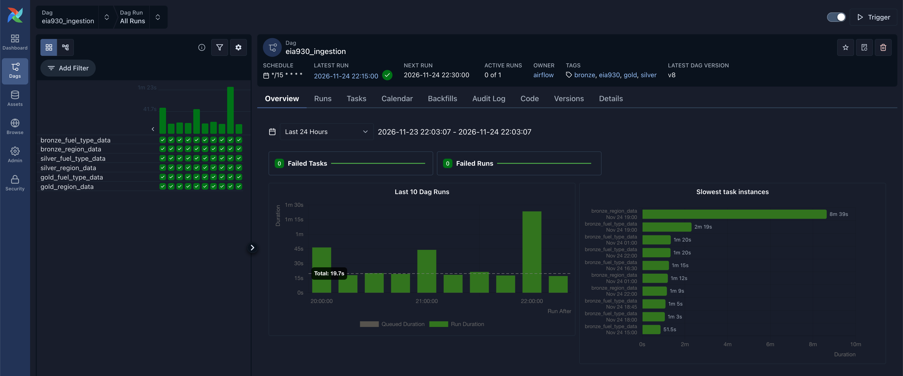
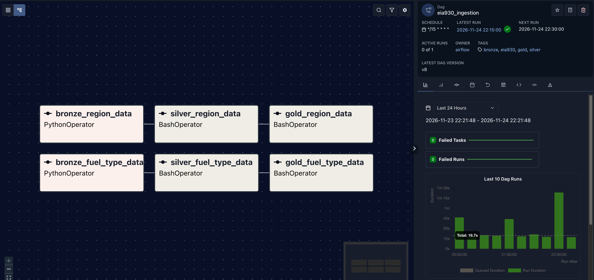
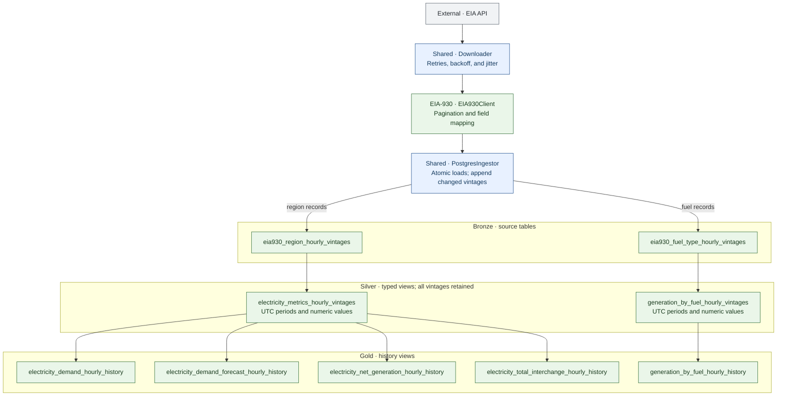

# EIA-930 electricity

[Back to data sources](../../README.md#data-sources)

Hourly electricity demand, day-ahead demand forecasts, net generation, total
interchange, and generation by energy source.

## Setup

Register for a free [EIA API key](https://www.eia.gov/opendata/register.php) and set
`EIA_API_KEY` in the project's `.env` file. After starting local services, enable
`eia930_ingestion` in Airflow. It polls every 15 minutes.

Each EIA client spaces request starts at least one second apart, including retries.
With two dataset tasks in each of local and production, this targets at most four
requests per second in total. Additional concurrent clients add to that rate.

The default collection window covers the previous 72 hours and the next 48 hours.
For a historical load, trigger the DAG with both `start` and `end` set to whole
UTC hours; `start` is inclusive and `end` is exclusive. The optional `respondents`
parameter filters balancing authorities or regions; an empty list requests all.

## Datasets

| API dataset | Bronze table | Silver view |
| --- | --- | --- |
| `region-data` | `eia930_region_hourly_vintages` | `electricity_metrics_hourly_vintages` |
| `fuel-type-data` | `eia930_fuel_type_hourly_vintages` | `generation_by_fuel_hourly_vintages` |

## Pipeline

**Airflow overview:** scheduled runs, task status, and execution times.



**DAG graph:** independent region and fuel pipelines, each flowing through Bronze → Silver → Gold.



**Data flow:** shared Python components load source-specific tables; dbt builds
the downstream views through model references.

**Legend:** blue = shared platform, green = pipeline-specific code/data,
gray = external source.



- **Bronze:** download each dataset and append changed versions in one transaction.
- **Silver:** validate the source and build typed staging views from `dbt/models/staging/eia930/`.
- **Gold:** build the dataset's history views from `dbt/models/marts/`.

There is one active DAG run at a time. Each downstream task requires its own
upstream task to succeed. Gold does not rebuild Silver.

Unchanged polls add no rows; A → B → A retains all three versions. History keeps
`observed_at`, `inserted_at`, and `ingestion_run_id`. Silver and Gold are views,
so committed source changes are visible immediately; dbt builds validate data
and update view definitions.

## Gold history views

| View in `gold` | Grain |
| --- | --- |
| `electricity_demand_hourly_history` | Hour × respondent × version |
| `electricity_demand_forecast_hourly_history` | Hour × respondent × version |
| `electricity_net_generation_hourly_history` | Hour × respondent × version |
| `electricity_total_interchange_hourly_history` | Hour × respondent × version |
| `generation_by_fuel_hourly_history` | Hour × respondent × fuel × version |

Use a point-in-time query to retrieve the versions observed as of a UTC cutoff:

```sql
SELECT period, respondent, value, value_units
FROM gold.electricity_demand_hourly_history
WHERE known_from <= TIMESTAMPTZ '2026-11-24 00:00:00+00'
  AND (known_until > TIMESTAMPTZ '2026-11-24 00:00:00+00'
       OR known_until IS NULL);
```

The cutoff uses collection time, not EIA publication time. Every Gold view retains
all revisions and their provenance. For current data, use
`WHERE known_until IS NULL`; current NULL values remain NULL. Electricity views
share `value` and `value_units` columns; fuel history uses `generation` and
`generation_units`. The dashboard shows all revisions by default.
