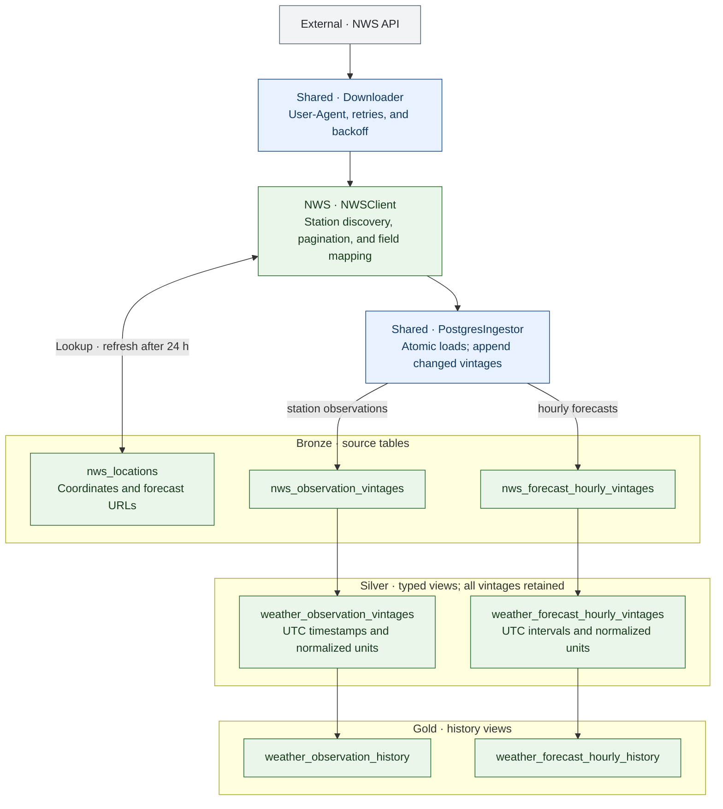

# NWS weather

[Back to data sources](../../README.md#data-sources)

Station observations and hourly forecasts from the National Weather Service,
with collected revisions preserved for point-in-time analysis.

## Setup

The [NWS API](https://www.weather.gov/documentation/services-web-api) is free and
requires no API key or source-specific environment settings. The shared downloader
supplies the identifying User-Agent.

After starting local services, enable `nws_ingestion` in Airflow. It polls every
15 minutes. Production deployment enables the DAG on first installation and
preserves its paused state on later deployments.

Each run collects the previous 48 hours of observations and the available hourly
forecast horizon. To recover an observation gap, trigger the DAG with
`observation_lookback_days` set to a number from 1 to 7; the default is 2.

## Datasets

| Dataset | Bronze table | Silver view |
| --- | --- | --- |
| Location metadata | `nws_locations` | — |
| Station observations | `nws_observation_vintages` | `weather_observation_vintages` |
| Hourly forecasts | `nws_forecast_hourly_vintages` | `weather_forecast_hourly_vintages` |

The pilot covers five airport stations. Forecasts use each station's coordinates;
these are local samples, not weather averages for the whole electricity market.
Locations are configured in [the NWS source client](../../src/data_platform/sources/nws.py).

| Location | Station |
| --- | --- |
| New York City | `KJFK` |
| Albany | `KALB` |
| Buffalo | `KBUF` |
| Rochester | `KROC` |
| Syracuse | `KSYR` |

## Pipeline

[The Airflow DAG](../../dags/nws_ingestion.py) has independent observation and
forecast branches, each flowing through **Bronze → Silver → Gold**.

**Data flow:** shared Python components download and load weather records; dbt
builds downstream views through model references.

**Legend:** blue = shared platform, green = source-specific code/data,
gray = external source.



- **Bronze:** append changed weather records in one transaction per location and dataset. Preserve source values, units, and quality codes.
- **Silver:** validate raw values and units, then build typed staging views from `dbt/models/staging/nws/`. Missing values remain null; quality codes pass through unchanged.
- **Gold:** build history views from `dbt/models/marts/`, retaining collected revisions and their provenance.

There is one active DAG run at a time. Each downstream task requires its own
upstream task to succeed. Gold does not rebuild Silver. A location failure retries
its dataset without discarding other locations' committed data.

Unchanged polls add no rows; A → B → A retains all three versions. Silver and Gold
are views, so committed source changes are visible immediately; dbt builds validate
data and update view definitions. CI uses mocked NWS responses.

Both branches reuse `nws_locations`, refreshing entries after 24 hours or when a
configured station changes. Postgres coordinates concurrent refreshes. A failed
refresh preserves the previous metadata and causes the collection task to retry.
This lookup table holds the latest metadata, not revision history.

## Bronze → Silver → Gold columns

Weather follows the EIA-930 convention: Bronze has explicit source columns,
Silver casts and normalizes them, and Gold adds collection-time history intervals.
There is no JSON `payload` or `source_data` column in these weather tables or views.

| Bronze | Silver | Gold |
| --- | --- | --- |
| `location`, `location_name`, `station_id`, `latitude`, `longitude` | Passed through | Passed through |
| `period` | Passed through as a UTC-aware timestamp | Passed through; part of the observation identity |
| `<metric>_value` as text and `<metric>_units` as the original NWS unit code | Cast to numeric and converted to the units below | Normalized value passed through |
| `<metric>_quality_code` | Passed through unchanged | Passed through unchanged |
| Forecast `period_end` and `source_updated_at` as source timestamp text | Cast to timezone-aware timestamps | Passed through |
| Forecast `wind_direction` as compass text | Passed through | Passed through |
| `observed_at`, `inserted_at`, `ingestion_run_id` | Passed through | Passed through |
| — | — | Adds `known_from` and `known_until` |

For example, an NWS wind speed of `36` with unit code `wmoUnit:km_h-1` becomes
Bronze `wind_speed_value = '36'` and `wind_speed_units = 'wmoUnit:km_h-1'`.
Silver converts it to `wind_speed_ms = 10`; Gold retains that value and records
when this version was known. Bronze does not convert weather values or units.

The metric prefixes are `temperature`, `dewpoint`, `relative_humidity`,
`wind_speed`, and `wind_gust` for both datasets; observations also have
`wind_direction` and `precipitation_last_hour`, and forecasts have
`precipitation_probability`. Quality codes remain null when NWS does not supply
them. Unused API presentation fields, such as icons and sequential period numbers,
are not stored and do not create revisions.

Observation timestamps are parsed into `period` during ingestion to provide a
consistent identity across UTC offsets and daylight-saving transitions. Unlike
EIA's UTC hour strings, NWS timestamps can include offsets and sub-hour precision.
No observation time is rounded to the hour.

## Gold history views

| View in `gold` | Grain |
| --- | --- |
| `weather_observation_history` | Location × station × exact observation time × version |
| `weather_forecast_hourly_history` | Location × station × forecast target hour × version |

The timestamps describe different events:

| Column | Meaning |
| --- | --- |
| `period` | Observation time, or the start of the forecast target interval |
| `period_end` | End of the forecast target interval; forecasts only |
| `source_updated_at` | NWS `updateTime`: last update of the data used to generate the forecast; forecasts only |
| `observed_at` / `known_from` | When our downloader received this version |
| `known_until` | Collection time of the next version; null for the latest stored version |
| `inserted_at` | When this version was inserted into Postgres |

`source_updated_at` is source metadata, not a guarantee of publication time.
NWS separately defines `generatedAt` as the response's generation time; we do not
use it to create weather revisions. The definitions are in the
[NWS API schema](https://api.weather.gov/openapi.json).

Use a point-in-time query to retrieve forecasts known at a UTC cutoff.
`known_from` is inclusive and `known_until` is exclusive:

```sql
SELECT location, period, temperature_c, wind_speed_ms, source_updated_at
FROM gold.weather_forecast_hourly_history
WHERE known_from <= TIMESTAMPTZ '2026-11-26 10:00:00+00'
  AND (known_until > TIMESTAMPTZ '2026-11-26 10:00:00+00'
       OR known_until IS NULL)
  AND period >= TIMESTAMPTZ '2026-11-26 10:00:00+00';
```

The cutoff uses collection time, never the weather time or NWS update time.
A forecast collected today cannot be used as an input to a prediction made
yesterday. Both views retain `ingestion_run_id` to identify the collection attempt.

For the latest stored versions, use `WHERE known_until IS NULL`; current null
values remain null. Old forecast targets also have a latest stored version, so
filter `period` separately when looking for upcoming weather. The dashboard shows
all revisions by default.

## Fields and units

| Columns | Unit | Availability |
| --- | --- | --- |
| `temperature_c`, `dewpoint_c` | °C | Both datasets |
| `relative_humidity_pct` | Percent | Both datasets |
| `wind_speed_ms`, `wind_gust_ms` | m/s | Both datasets, where supplied |
| `wind_direction_degrees` | Degrees | Observations |
| `wind_direction` | Compass direction | Forecasts |
| `precipitation_last_hour_mm` | mm over the previous hour | Observations |
| `precipitation_probability_pct` | Percent | Forecasts |

Weather history begins when collection starts. The live API retains only seven
days of observations, and missed forecast versions cannot be recovered from these
endpoints. Updates between 15-minute polls may not be captured.
